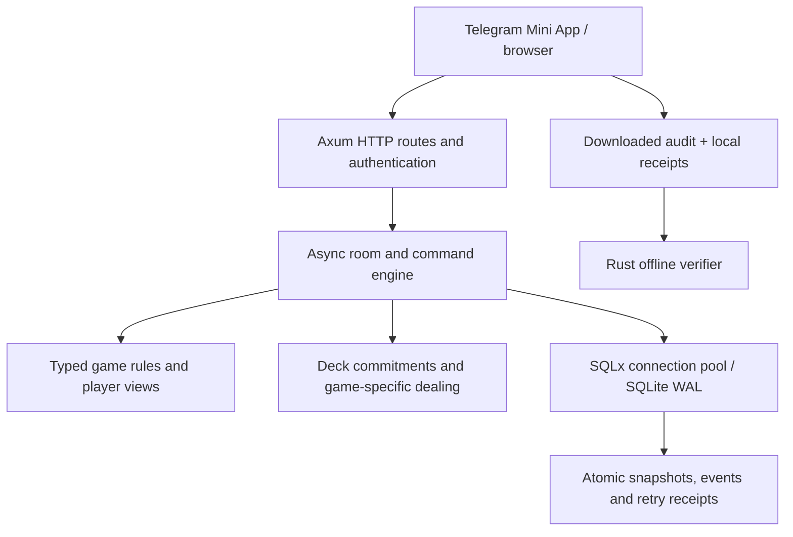

# Pastimer

A Rust server for multiplayer Telegram card games, with SQLite persistence and a shared Mini App. **Thousand / тысяча is the first complete game**, with the agreed house rules for three or four players. See the [English rules](docs/thousand-rules.md) or [русские правила](docs/thousand-rules.ru.md). `high-card-demo` is a five-round infrastructure exercise for 2–4 players.

Live deployment: [1000.vartanyan.com](https://1000.vartanyan.com). Open [@pastimerbot](https://t.me/pastimerbot) in Telegram and use `Play / Играть` for signed Mini App access. [Horse deployment and verification record](docs/horse-transfers-marriages-2026-11-14.md).

Starting a new session? Read the [handoff](docs/handoff.md) for implementation status, source map, local setup, validation and the live Horse deployment record. [AGENTS.md](AGENTS.md) records project conventions; the [screenshot gallery](docs/screenshots/README.md) shows the current UI.

## Run

Install the Rust toolchain pinned in `rust-toolchain.toml` (1.93.1, with rustfmt and Clippy), a C compiler and pkg-config. SQLx builds its bundled SQLite; no external database service is required.

```sh
# In this managed cloud, activate its workspace-local Rust installation:
. scripts/rust-env.sh
cargo run --locked
# Or, for browser development login:
DEV_AUTH=1 cargo run --locked
```

Default address: loopback, port 3000. The server binary embeds `public/` assets, so recompile after changing them. For release deployment:

```sh
cargo build --release --locked
PASTIMER_ENV=production ./target/release/pastimer
```

**The backend has no Node.js runtime dependency.** Node.js is used only for optional Playwright browser tests. `npm start`, `npm test` and `npm run check` remain convenience aliases for Rust commands.

Use separate browser profiles for different local players. Choose Тысяча, configure three or four seats and a barrel threshold, create a table, and share its eight-character join code. Fill the seats and start; the randomly selected dealer clicks **Shuffle & deal**. The deck hash is published and cards are dealt immediately, without player confirmations. Bid, take and distribute the stock, set the final order, and play. Each completed trick stays on the table for three seconds; every player’s own pile can be opened to inspect that player’s last collected trick. The next dealer starts the next deal.

The older high-card demo retains its original acknowledgement workflow for compatibility. Its five rounds award a point for the highest rank, including ties.

The shared interface uses a felt card table, illustrated vector playing cards and an overlapping hand that sorts by suit or rank. Seats highlight the current player; stock transfers preview the chosen cards and prevent duplicate selections. Card artwork is bundled locally and scales to mobile and desktop displays.

For testing without recruiting a full table, choose **Computer seats** when creating a Thousand room. With three seats, **2 computers - solo** lets you play alone; **1 computer - 2 people** needs you and one friend. Four-seat tables can also include computers. They calculate conservative bids from guaranteed winning leads and an attainable marriage, retain those cards when distributing, cash winners before declaring trump, and try to win playable tricks. They use only their own view and public played cards. Turns are paced at three seconds so each reaction is visible. When a computer is the dealer, press **Ask computer to deal**; completed results stay available until someone starts the next deal.

The table fits the visible Mini App screen. Tap a legal card to play it immediately; an eligible marriage is announced by default when you lead its king or queen. Switch its option off first to play without announcing. The current trump is marked prominently by gold rings and its suit. Drag distribution cards from your hand onto the respective player hands. Tap each staged card to turn it face up (open) or face down (secret), or drag it back to cancel. Press Give two cards on the table once both are ready. A secret incoming card is revealed with one tap and sorted into your hand with the next. Opened stock is enlarged and disappears once taken. Tap a player's seat or hand/count indicator to inspect their last won trick. Auction speech bubbles retain the latest calls until the auction ends, then give way to the contractor and contract. Closing and reopening restores your table through your authenticated identity, even in a fresh browser window.

`DEV_AUTH=1` allows loopback-only login and is forbidden in production. Every local sign-in creates a new identity; the cookie preserves it for one day. `.env.example` documents configuration; environment files are not automatically loaded. `PASTIMER_ENV=production` enables production behavior; the previous `NODE_ENV=production` spelling is also accepted for compatibility. Supply real secrets through the deployment's environment, never a committed file.

SQLite defaults to `.data/pastimer.sqlite`, ignored by Git. Use a persistent private volume; stop the application before copying database files or use SQLite's online backup API. Preserve WAL files when appropriate. The Rust backend reads the original Node prototype's room snapshots, sessions and command receipts without resetting the database. A captured Node fixture tests persisted-state and cryptographic compatibility. Do not run both versions as writers during a migration.

## Shared architecture



- **Concurrency:** Tokio's multithreaded runtime handles async requests. SQLx executes SQLite operations on connection workers; a pool permits concurrent reads. Writes acquire `BEGIN IMMEDIATE` and remain serialized by SQLite. There is no global game-state mutex. The small per-IP rate-limit map has a short mutex, never held over an await.
- **Rules:** Game modules have concrete state, action and public-view types, joined by typed dispatch and shared `Outcome` transitions. Game outcomes are an enum: continue, shuffle, or finish with scores. Card inputs are validated at deserialization; lifecycle variants carry their required game state. Explicit public DTOs keep private game state separate from responses. Adding a game extends the typed dispatch alongside its rule implementation.
- **Rooms:** authenticated identities, random join codes, host-only start, capacity and membership checks, fixed seats once started, persistent reconnects.
- **Commands:** version checks, durable idempotency keys and atomic state/event/receipt updates. Lost-response retries reuse the original command, including after a page reload. Contending moves cannot silently overwrite one another.
- **Integrity:** OS-backed secure shuffle, salted deck commitments before dealing, sealed hidden moves, hash-linked public events and proof export after every completed or cancelled Thousand deal. The verifier reconstructs all card locations and replays the revealed rule actions.
- **Scores and UX:** a shared cumulative score ledger, per-deal checkpoints, sticks and barrel accounting. Shared lobby, seats, private hands, bid/order controls, per-card transfer visibility, marriage choices, separate trick piles and audit export. Polling refreshes every second; a deadline refresh closes tricks after three seconds. Disconnected players keep their seats and hands, without automatic forfeits.

See [architecture and trust model](docs/architecture.md) and [game authoring](docs/game-authoring.md). Rust prevents many memory/type mistakes; correctness of rules, secrecy, protocol design and transaction boundaries still requires tests.

## Checks

```sh
cargo fmt --check
cargo clippy --all-targets --locked -- -D warnings
cargo test --locked
```

Rust tests cover complete Thousand matches, the attainable 380-point maximum, barrel auctions/scoring, dealer bonuses, sticks, late four-nines cancellation, per-player trick piles, deadline recovery, privacy, rule replay, proof tampering, concurrent commands, rollback, Telegram signatures and Node snapshot/hash compatibility. Unsafe code is forbidden in this application's crate; Clippy denies `unwrap` and `expect`.

Optional browser test (Node.js 22+):

```sh
npm ci
# Use system Chromium, set CHROMIUM_PATH, or install Playwright Chromium:
# npx playwright install chromium
npm run test:browser
```

The browser suites start isolated Rust servers and exercise the existing demo plus three- and four-player Thousand. They cover full card play, actual three-second closure, a here auction, mixed-visibility transfers, dismissal, audit verification, and lost-response retries across reload. Mobile screenshots are written to `/tmp/pastimer-mobile.png` and `/tmp/pastimer-thousand-mobile.png`. `PASTIMER_BIN` can select a release binary for this test.

For this managed cloud, `bash scripts/install-cloud.sh` installs/activates the pinned Rust toolchain and refreshes dependencies and the debug build. Other machines should use their normal Rust installation.

## Telegram deployment

1. Configure a BotFather bot and Mini App/menu button pointing to your deployed **HTTPS** URL.
2. Supply `TELEGRAM_BOT_TOKEN` securely, set `PASTIMER_ENV=production`, and leave `DEV_AUTH` unset. Set `HOST` and `PORT` for your hosting platform. Use a trusted TLS reverse proxy that preserves the Host header; keep the backend HTTP port private.
3. Serve the Mini App and API on the same origin. The page loads Telegram's SDK from `telegram.org`; the server verifies signed `initData` locally. There is no outbound Bot API call.
4. Validate real Telegram identity, three-/four-player joining and a complete proof export. This remains outstanding until a bot and HTTPS deployment exist.

The cloud development workspace is not production hosting. The current storage target is one host with a private persistent SQLite volume. Multiple workers/hosts require a separate deployment design; a connection pool does not make SQLite a distributed database.

## Commands and audit verification

Create a Thousand room with `POST /api/rooms`:

```json
{"game":"thousand","options":{"playerCount":3,"barrelThreshold":900}}
```

Send game actions through the existing versioned command endpoint, `POST /api/rooms/{code}/commands`:

```json
{"version":8,"requestId":"unique-request-id","action":{"type":"thousand","action":{"type":"bid","amount":110}}}
```

Thousand actions are `shuffle`, `bid`, `pass`, `here`, `takeStock`, `distribute`, `order`, `dismiss`, `fourNines`, and `play`. A play includes `card` and optional `announce`; distribution supplies two `{player,card,public}` transfers. Use the current player’s typed `table.controls` to render permitted actions. Room state exposes `options`, cumulative `scores`, and a per-player `table` view.

Download the audit after any completed or cancelled deal, then:

```sh
cargo run --locked --bin verify-audit -- pastimer-XXXXXXXX.json
```

Thousand exports `pastimer-audit-v2`: initial deck order and salt for every settled deal, all card movements, tricks, public rule events, sealed-command reveals, score checkpoints and cancellations. The current unfinished deal stays private. The verifier checks hashes and browser receipts, reconstructs card ownership and legal tricks, and replays the revealed auction/play actions and scoring. Existing `pastimer-audit-v1` demo exports remain supported. Preserve receipts outside the server; the trust document describes the remaining limits against a dishonest operator.

Horse/k3s container, persistent-volume manifests and BotFather instructions: [deployment guide](docs/deployment.md).

Generate mobile Mini App previews with signed test Telegram identities (no real bot token needed):

```sh
node scripts/capture-screenshots.mjs
```

The helper starts an isolated server, drives real game actions, and writes bidding, distribution, trick-play and collected-trick views to `artifacts/screenshots/`. These are browser previews, not captures from a live Telegram client.

Reviewed previews are also committed in [docs/screenshots/](docs/screenshots/README.md) for local sessions and repository browsing.
